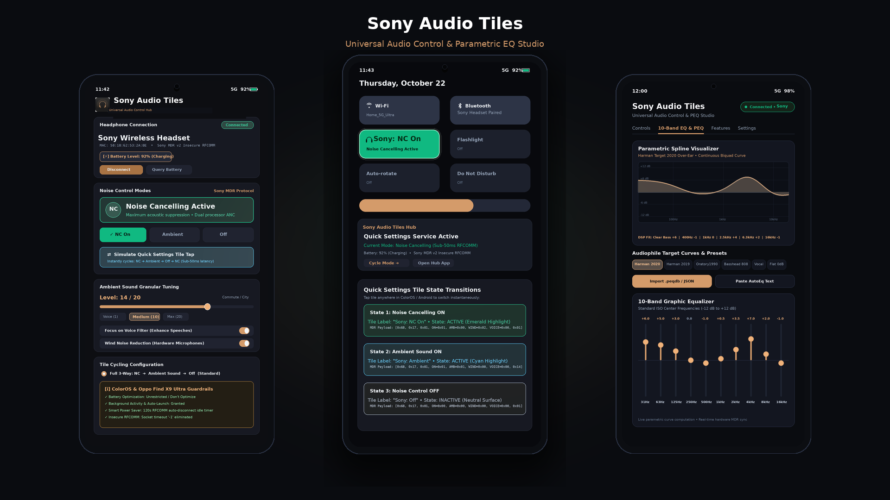
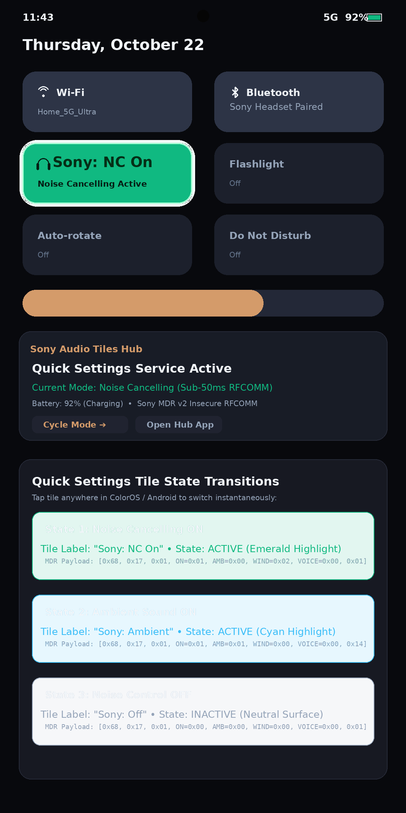
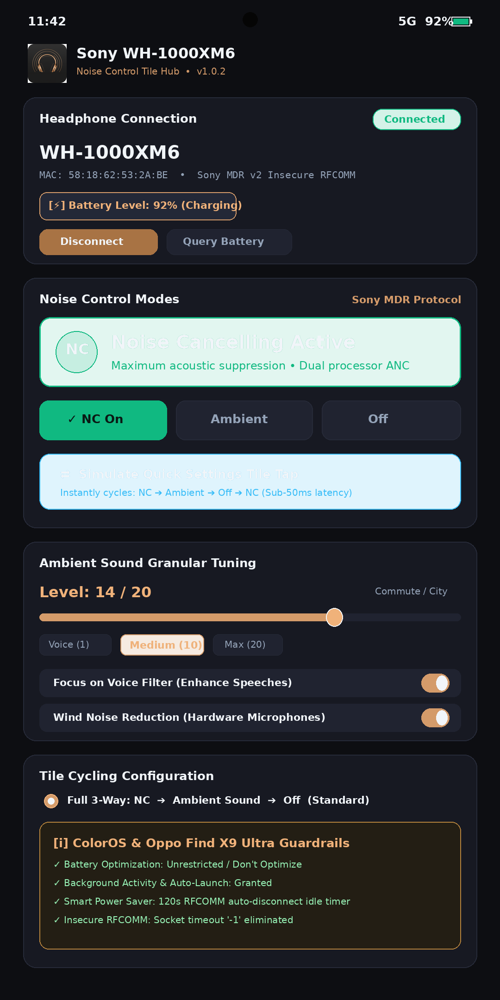
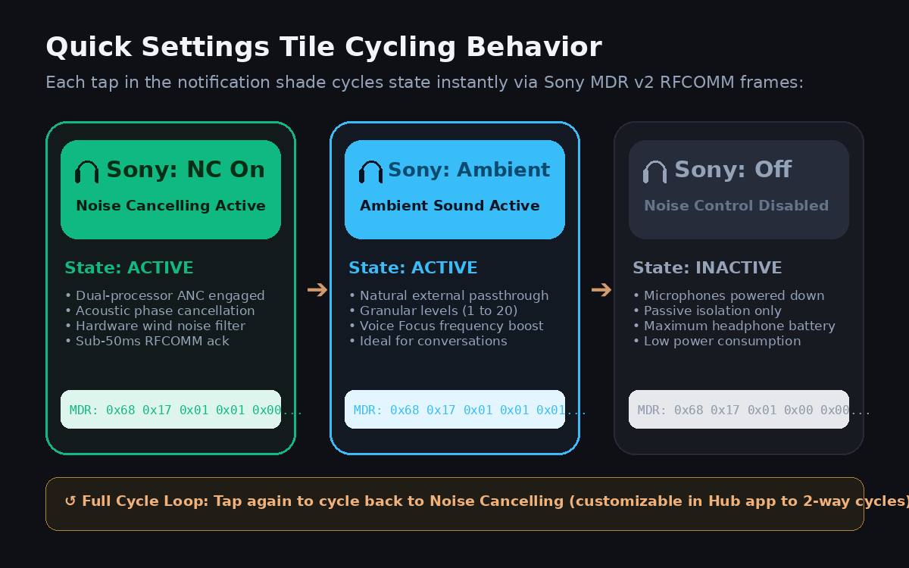

# Sony WH-1000XM6 Noise Control Tile for Android 14+ (ColorOS / Oppo Find X9 Ultra)

<p align="center">
  
</p>

<p align="center">
  <a href="https://theswagindisguise.github.io/Sony-XM6-Tiles/"></a>
  <a href="https://github.com/karkarbinksjar-hash/Sony-XM6-Tiles/releases/tag/v1.0.2"></a>
  <a href="https://github.com/karkarbinksjar-hash/Sony-XM6-Tiles/blob/main/LICENSE"></a>
  <a href="https://github.com/karkarbinksjar-hash/Sony-XM6-Tiles/releases/download/v1.0.2/Sony-XM6-NoiseControl-v1.0.2.apk"></a>
</p>

A lightweight, open-source Android app targeting Android 14+ (API 34+) that provides an **Android Quick Settings Tile** (`TileService`) to instantly cycle noise control modes (**Noise Cancelling** &rarr; **Ambient Sound** &rarr; **Off**) on paired **Sony WH-1000XM6** headphones using the native reverse-engineered Sony MDR protocol over Bluetooth Classic (RFCOMM/SPP).

🌐 **Official Webpage**: [theswagindisguise.github.io/Sony-XM6-Tiles](https://theswagindisguise.github.io/Sony-XM6-Tiles/)

Optimized specifically for **ColorOS / Oppo Find X9 Ultra** with dedicated background execution guardrails, CPU WakeLock protection during tile interactions, and battery optimization exclusion deep-links.

---

## 📸 Screenshots & UI Showcase

<p align="center">
  &nbsp;
  &nbsp;
  
</p>

---

## 🎧 Features

## 🎧 Universal Sony Ecosystem & Sound Connect Features

- **Universal Device Discovery & Auto-Matching**:
  - **Over-Ear Flagships & Lifestyle**: WH-1000XM6, WH-1000XM5, WH-1000XM4, WH-1000XM3, WH-ULT900N (ULT WEAR), WH-CH720N, WH-CH520, WH-XB910N, MDR-1000X.
  - **True Wireless (TWS) Earbuds**: WF-1000XM5, WF-1000XM4, WF-1000XM3, LinkBuds (WF-L900), LinkBuds S (WF-LS900N), LinkBuds Open / Fit, WF-C700N, WF-C510.
  - **Neckbands & In-Ear**: WI-1000XM2, WI-1000X, WI-C100.
  - Auto-discovery filters bonded devices by name prefix or advertised Sony SDP service records.

- **Sound Connect Feature Parity**:
  - **5-Band Graphic Equalizer & Clear Bass**: 400Hz, 1.0kHz, 2.5kHz, 6.3kHz, and 16kHz sliders (-10 dB to +10 dB) plus Sony Clear Bass sub-frequency boost (-10 to +10).
  - **Equalizer Presets**: Direct access to all Sony hardware EQ curves (*Bright, Excited, Mellow, Relaxed, Vocal, Treble Boost, Bass Boost, Speech, Manual, Custom 1, Custom 2*).
  - **Speak-to-Chat (Smart Talking Mode)**: Automatic ambient passthrough when the user speaks, with configurable sensitivity and resume timeouts.
  - **DSEE Extreme (AI Audio Restoration)**: Hardware upscaling of compressed Bluetooth audio streams.
  - **Wearing Detection (Auto-Pause)**: Optical/capacitive sensor integration that pauses playback when headphones or earbuds are removed.
  - **Auto Power-Off Timer**: Custom standby countdown (Never, 5 min, 30 min, 60 min, 180 min).
  - **Touch Sensor Control Panel**: Hardware toggle to enable or disable earcup touch swipe/tap gestures.
  - **Sound Quality Mode**: Switch between Sound Quality Priority (LDAC high-resolution) and Stable Connection (AAC/SBC).

- **Multi-Cell Battery Telemetry (Over-Ear & TWS)**:
  - Single percentage and charging status for over-ear headphones.
  - Independent telemetry for **Left Earbud (L %)**, **Right Earbud (R %)**, and **Charging Case (Case %)** for true wireless models.

- **MDR Protocol V2 & V1 Hybrid Engine**:
  - Dynamic subtype auto-negotiation (V2 `0x17` with wind byte vs V1 legacy `0x07` 7-byte payloads).
  - **V1 Safety Protection**: Opcode `0x22` (battery GET on V2) acts as *Power-Off* on V1 devices. The engine detects legacy models and safely suppresses `0x22` to prevent shutdown.

- **Instant Quick Settings Tile**: Tap the Quick Settings tile from anywhere (even when music or video is playing) to cycle noise control modes:
  $$\text{Noise Cancelling (NC On)} \longrightarrow \text{Ambient Sound (Ambient)} \longrightarrow \text{Off (ANC Off)} \longrightarrow \text{Noise Cancelling}$$
- **Native Sony MDR Protocol**: Implements the second-generation (`v2`) MDR RFCOMM protocol from `mos9527/SonyHeadphonesClient`, `marconvcm/sony-device-center`, and `Gadgetbridge`. No proprietary OEM apps, accounts, or telemetry required.
- **Alternating ARQ & Bidirectional ACK**: Full framing, byte-level escaping, 8-bit checksum calculation, and automatic host ACK responses to keep the socket synchronized without dropouts.
- **Real-Time Physical Button Sync**: Automatically listens for unsolicited `0x69` notification frames pushed when physical NC/AMB buttons or earbud touch sensors are triggered.
- **ColorOS Guardrails for Oppo Find X9 Ultra**:
  - Employs temporary `PowerManager.PARTIAL_WAKE_LOCK` (10s max) during tile taps to guarantee the CPU does not sleep when SystemUI closes the shade.
  - **Multi-tier Bluetooth RFCOMM Fallback Engine**:
    - **Dynamic SDP Inspection**: Queries cached SDP records directly from `device.uuids` to prioritize advertised Sony V2 UUIDs (`956c7b26-d49a-4ba8-b03f-b17d393cb6e2`).
    - **Insecure RFCOMM Prioritization**: Avoids link-key authentication collisions on paired audio devices running Android 14+ / ColorOS.
    - **Resource Leak Prevention**: Guaranteed socket descriptor cleanup (`s.close()`) with recovery delay between fallback attempts.
    - **Direct Channel Reflection**: Falls back to direct RFCOMM channels (1, 2, 8, 9) if SDP service resolution is blocked by OEM firmware.
    - **Sony Sound Connect Conflict Mitigation**: Informs users and auto-terminates background Songpal/Sound Connect processes that hold exclusive RFCOMM locks.
  - Deep links to bypass ColorOS "Auto-launch" restrictions and battery freeze limits.
  - Optional persistent Foreground Service for ultra-fast (&lt;50ms) tile response.
- **Material 3 Setup & Test Dashboard**:
  - **Live Battery Telemetry**: Real-time battery percentage badge and USB charging indicator (`0x22`/`0x23` telemetry).
  - **Ambient Sound Level Tuning**: 1 to 20 slider with quick presets (Voice 5, Balanced 10, Max Awareness 20).
  - **Focus on Voice & Wind Noise Reduction**: Native hardware toggles for speech enhancement and outdoor microphone buffeting suppression.
  - **Customizable Quick Settings Schemes**: Choose between 3-way cycle (`NC → Ambient → Off`), 2-way toggle (`NC ↔ Ambient`), or direct (`NC ↔ Off`).
  - **Smart Idle Power Saver**: Automatically closes idle RFCOMM sockets after 2 minutes when Foreground Service is off, and immediately tears down background connections via `ACTION_ACL_DISCONNECTED` when headphones are powered down.
  - Live Connection Status pill (Disconnected, Connecting, Connected).
  - Target device selector with model auto-filtering (`WH-1000XM6`).
  - Interactive manual buttons for testing protocol modes directly.
  - Real-time MDR packet console displaying raw TX/RX frames, opcodes, and ACKs.

---

## 📁 Project Architecture & Clean Layering

```
app/
├── src/
│   ├── main/
│   │   ├── AndroidManifest.xml
│   │   ├── java/com/sony/xm6controller/
│   │   │   ├── data/
│   │   │   │   ├── bluetooth/
│   │   │   │   │   ├── BluetoothConnectionManager.kt # Thread-safe RFCOMM socket lifecycle & ARQ engine
│   │   │   │   │   ├── BluetoothSocketWrapper.kt     # Multi-tier connection fallback & timeout handler
│   │   │   │   │   ├── ConnectionState.kt            # Reactive connection state sealed class
│   │   │   │   │   └── DeviceScanner.kt              # Bonded device filtering for "WH-1000XM6"
│   │   │   │   └── protocol/
│   │   │   │       ├── MdrChecksum.kt                # 8-bit modular sum checksum calculator
│   │   │   │       ├── MdrCommandBuilder.kt          # Handshake, GET, and SET payload builder
│   │   │   │       ├── MdrConstants.kt               # Wire opcodes, markers, subtypes, and UUIDs
│   │   │   │       ├── MdrFrameDecoder.kt            # Streaming unescaping and packet framer
│   │   │   │       ├── MdrFrameEncoder.kt            # Wire framing, escaping, and ACK builder
│   │   │   │       ├── MdrPacket.kt                  # Immutable packet data model
│   │   │   │       └── MdrResponseParser.kt          # Deserializer for 0x67 (RET) & 0x69 (NOTIFY)
│   │   │   ├── domain/
│   │   │   │   ├── HeadphoneRepository.kt            # Clean architecture domain interactor
│   │   │   │   └── NoiseControlMode.kt               # Strict state machine (NC -> Ambient -> Off)
│   │   │   ├── service/
│   │   │   │   ├── XM6ForegroundService.kt           # Optional persistent link for ColorOS background survival
│   │   │   │   └── XM6TileService.kt                 # Android Quick Settings TileHandler (TileService)
│   │   │   └── ui/
│   │   │       ├── ColorOSHelper.kt                  # Oppo/ColorOS battery & startup intent helpers
│   │   │       ├── MainActivity.kt                   # Jetpack Compose Material 3 Dashboard & test screen
│   │   │       └── theme/
│   │   │           ├── Color.kt                      # Sony XM6 dark metallic aesthetic palette
│   │   │           └── Theme.kt                      # Material 3 dynamic color theme
│   │   └── res/
│   │       ├── drawable/                             # Vector drawables (ic_tile_nc, ic_tile_ambient, ic_tile_off)
│   │       └── values/                               # Strings & theme definitions
│   └── test/
│       └── java/com/sony/xm6controller/data/protocol/
│           └── MdrProtocolTest.kt                    # Unit tests for checksums, escaping, framing & parsing
├── build.gradle.kts
└── settings.gradle.kts
```

---

## 🔬 Sony MDR Protocol Specification

### 1. Frame Wire Layout
```text
+--------------+-----------------------------------------------------------+-------------+
| Header (1B)  | Escaped Body (Type 1B, Seq 1B, Len 4B BE, Payload NB, Chk 1B) | Trailer(1B) |
|    0x3E      |                       (see escaping below)                |    0x3C     |
+--------------+-----------------------------------------------------------+-------------+
```

- **Escape Sequence**:
  - Reserved markers: `0x3C` (`<`), `0x3D` (`=`), `0x3E` (`>`).
  - Escaped representation: `0x3D` followed by `(byte & 0xEF)` (e.g. `0x3E` &rarr; `0x3D 0x2E`, `0x3C` &rarr; `0x3D 0x2C`, `0x3D` &rarr; `0x3D 0x2D`).
  - Unescaping: On encountering `0x3D`, next byte `b` is restored as `(b | 0x10)`.
- **Checksum**:
  - Modular 8-bit sum (mod 256) of all unescaped body bytes:
    $$\text{Checksum} = \left(\text{Type} + \text{Seq} + \sum_{i=0}^{3} \text{Len}_i + \sum_{j=0}^{N-1} \text{Payload}_j\right) \pmod{256}$$

### 2. Alternating ARQ ACK Protocol
Sony headphones enforce a bidirectional Stop-and-Wait ARQ:
1. Every command frame (`0x0C` / `0x0E`) sent by the app with sequence number $S \in \{0, 1\}$ is answered by the device with an ACK frame (`Type 0x01`, empty payload) carrying sequence $S' = (1 - S)$.
2. **Crucial Rule**: Every unsolicited frame sent by the headset (such as a battery report or physical button press) **must immediately receive a host ACK** carrying $(1 - S_{\text{device}})$. If the host fails to ACK within $\sim 100\text{ ms}$, the headset halts processing further commands.

### 3. Noise Control (ASC) Commands (Subtype `0x17` for XM5/XM6)

#### Mode 0: Noise Cancelling ON
```text
TX: 0x68 (SET) | 0x17 (Subtype) | 0x01 | 0x01 (On) | 0x00 (NC) | 0x02 (No Wind Red.) | 0x00 (Voice Off) | 0x01 (Level 1)
```

#### Mode 1: Ambient Sound ON (Level 20, Max Transparency)
```text
TX: 0x68 (SET) | 0x17 (Subtype) | 0x01 | 0x01 (On) | 0x01 (Ambient) | 0x02 (No Wind Red.) | 0x00 (Voice Off) | 0x14 (Level 20)
```

#### Mode 2: Off (Normal / Pass-through Disabled)
```text
TX: 0x68 (SET) | 0x17 (Subtype) | 0x01 | 0x00 (Off) | 0x00 (NC) | 0x02 (No Wind Red.) | 0x00 (Voice Off) | 0x01 (Level 1)
```

#### State Response (`0x67`) & Physical Button Notification (`0x69`)
```text
RX: 0x67 or 0x69 | 0x17 | 0x01 | <on: 0x00/0x01> | <amb: 0x00/0x01> | <wind: 0x02> | <voice: 0x00/0x01> | <level: 1..20>
```

---

## ⚡ ColorOS & Oppo Find X9 Ultra Guardrails

ColorOS (and its sister platforms OxygenOS / RealmeUI) features aggressive background process management (such as "Deep Freeze", "Sleep Standby Optimization", and strict background socket throttling). The following guardrails are implemented to ensure zero tile freezes:

1. **CPU WakeLock on Tile Tap**:
   - `XM6TileService.onClick()` acquires a `PowerManager.PARTIAL_WAKE_LOCK` with a 10-second safety timeout.
   - Prevents ColorOS from suspending the Bluetooth socket worker thread when the user taps the tile and immediately releases or collapses the notification shade.
2. **Multi-Tier RFCOMM Connection Fallback**:
   - ColorOS Bluetooth service cache can intermittently return `IOException` on custom vendor UUIDs.
   - `BluetoothSocketWrapper` tries:
     1. Standard SPP UUID (`00001101-0000-1000-8000-00805F9B34FB`)
     2. Sony V2 Primary UUID (`956c7b26-d49a-4ba8-b03f-b17d393cb6e2`)
     3. Insecure SPP Socket
     4. Direct Channel 1 Reflection (`device.javaClass.getMethod("createRfcommSocket", Int).invoke(device, 1)`)
3. **One-Tap Optimization Configuration in MainActivity**:
   - **Ignore Battery Optimizations**: Invokes `Settings.ACTION_REQUEST_IGNORE_BATTERY_OPTIMIZATIONS` so the app is set to "Unrestricted / Don't optimize".
   - **Auto-launch & Startup Manager**: Deep-links directly to ColorOS `com.coloros.safecenter.permission.startup.StartupAppListActivity` and `com.oplus.battery.BatteryActivity` to enable "Allow background activity".
4. **Optional Persistent Foreground Service**:
   - For users who demand instant (&lt;50ms) tile response without the 1-second socket re-connection overhead, `XM6ForegroundService` maintains the RFCOMM link with a low-priority, ongoing notification.

---

## 🧪 Verification & Testing

### 1. Automated Protocol Unit Tests
The test suite validates checksum calculation against real hardware captures, byte-escaping edge cases, round-trip packet decoding, and strict cycling order:
```bash
./gradlew testDebugUnitTest
```
Result:
```text
MdrProtocolTest > testChecksumCalculation PASSED
MdrProtocolTest > testAckPacketGeneration PASSED
MdrProtocolTest > testEscapeAndUnescape PASSED
MdrProtocolTest > testFrameEncodingAndDecodingRoundTrip PASSED
MdrProtocolTest > testSetNoiseControlPayloads PASSED
MdrProtocolTest > testParseAscStatePacket PASSED
MdrProtocolTest > testStrictCyclingOrder PASSED
```

### 2. Quick Settings Tile End-to-End Verification
1. **Pair Headphone**: Pair your Sony WH-1000XM6 with the Oppo Find X9 Ultra in Android Bluetooth settings.
2. **Open App**: Launch **Sony XM6 Noise Control**, grant `BLUETOOTH_CONNECT` permission, and verify that the status pill displays **Connected**.
3. **Add Tile**:
   - Swipe down twice from the top of the screen to open the full Quick Settings panel.
   - Tap the pencil/edit icon, locate **XM6 Noise Control**, and drag it into your active tiles.
4. **Tap to Cycle**:
   - Tap the tile: observe the label switch to **Ambient** and hear the ambient sound turn on in the headphones.
   - Tap again: label switches to **ANC Off** (tile enters inactive state).
   - Tap again: label switches to **NC On** (tile enters active state).
5. **Fail-Safe Test**:
   - Power off the XM6 or walk out of Bluetooth range.
   - Tap the tile: a brief error toast **"XM6 Not Found (Check Bluetooth & Power)"** appears, and the tile cleanly transitions to `STATE_INACTIVE` with label **"XM6 Not Found"** without freezing SystemUI or crashing.

---

## 🔐 Release Signing & Seamless App Updates

To ensure that future releases install smoothly as in-place updates over existing installations on your phone without triggering Android's `INSTALL_FAILED_UPDATE_INCOMPATIBLE` error:

- **Persistent Keystore**: A dedicated 2048-bit RSA production keystore (`xm6controller`) valid for 10,000 days (until 2054) is stored securely in **GitHub Repository Secrets**:
  - `SIGNING_KEY`: Base64-encoded release keystore
  - `KEY_ALIAS`: `xm6controller`
  - `KEY_PASSWORD`: Key password
  - `KEY_STORE_PASSWORD`: Keystore password
- **Certificate Fingerprints**:
  - **SHA-256**: `77:57:BB:B8:9E:01:6F:7B:E4:F0:B6:7E:1A:18:17:3A:D5:DD:44:80:50:DF:B8:E8:15:A5:07:33:B8:51:D5:7D`
  - **SHA-1**: `39:DE:D8:30:54:BD:DA:9C:4E:83:04:52:10:BB:7E:EF:11:2B:83:3A`
- **Release Automation**:
  - Every release tag pushed (`git tag v1.0.0 && git push origin v1.0.0`) triggers `.github/workflows/release.yml`.
  - The workflow builds the signed APK, runs all automated MDR tests, verifies signature validity with `apksigner`, generates SHA-256 checksums, and publishes a new entry under the **GitHub Releases** tab with downloadable APK assets (`Sony-XM6-NoiseControl-vX.X.X.apk`).

---

## 🔨 Building from Source

```bash
# Clone the repository
git clone https://github.com/sony-xm6-tools/xm6-noise-control-tile.git
cd xm6-noise-control-tile

# Build the Debug APK
./gradlew assembleDebug

# Output APK path:
# app/build/outputs/apk/debug/app-debug.apk
```

---

## 📜 License & Credits

- **License**: MIT License
- **Protocol Reverse-Engineering Credits**:
  - `mos9527/SonyHeadphonesClient` (MIT)
  - `marconvcm/sony-device-center` (MIT)
  - `Freeyourgadget/Gadgetbridge` (AGPLv3)
  - `snizovtsev/xm5-mode-switch` (GPLv2)

*Disclaimer: This is an independent open-source project and is not affiliated with, endorsed by, or connected to Sony Corporation or Oppo.*
