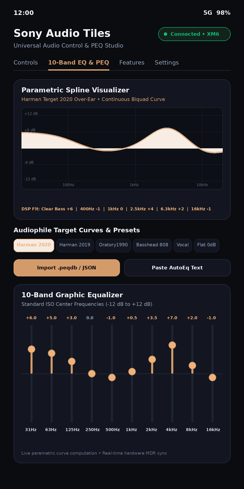

# Sony Audio Tiles — Universal Sony Headphones & TWS Quick Settings Control & PEQ Studio

<p align="center">
  
</p>

<p align="center">
  <a href="https://theswagindisguise.github.io/Sony-Audio-Tiles/"></a>
  <a href="https://github.com/TheSwagInDisguise/Sony-Audio-Tiles/releases/tag/v1.1.0"></a>
  <a href="https://github.com/TheSwagInDisguise/Sony-Audio-Tiles/blob/main/LICENSE"></a>
  <a href="https://github.com/TheSwagInDisguise/Sony-Audio-Tiles/releases/download/v1.1.0/Sony-Audio-Tiles-v1.1.0.apk"></a>
</p>

A lightweight, open-source Android app targeting Android 14+ (API 34+) providing an **Android Quick Settings Tile** (`TileService`) to instantly cycle noise control modes (**Noise Cancelling** &rarr; **Ambient Sound** &rarr; **Off**), a **10-Band Graphic Equalizer**, and a **PEQ Studio** with `.peqdb` and AutoEq profile import for the entire Sony wireless ecosystem using reverse-engineered native Sony MDR protocol over Bluetooth Classic (RFCOMM/SPP).

🌐 **Official Webpage**: [theswagindisguise.github.io/Sony-Audio-Tiles](https://theswagindisguise.github.io/Sony-Audio-Tiles/)

Optimized specifically for **ColorOS / Oppo Find X9 Ultra** and stock Android 14+ with dedicated background execution guardrails, CPU WakeLock protection during tile interactions, and battery optimization exclusion deep-links.

---

## 📸 Screenshots & UI Showcase

<p align="center">
  &nbsp;
  &nbsp;
  &nbsp;
  
</p>

---

## 🎧 Features

### 1. Universal Sony Ecosystem & Hardware Discovery
- **Over-Ear Flagships & Lifestyle**: WH-1000XM6, WH-1000XM5, WH-1000XM4, WH-1000XM3, WH-ULT900N (ULT WEAR), WH-CH720N, WH-CH520, WH-XB910N, MDR-1000X.
- **True Wireless (TWS) Earbuds**: WF-1000XM5, WF-1000XM4, WF-1000XM3, LinkBuds (WF-L900), LinkBuds S (WF-LS900N), LinkBuds Open / Fit, WF-C700N, WF-C510.
- **Neckbands & In-Ear**: WI-1000XM2, WI-1000X, WI-C100.
- **Auto-Discovery & Dynamic Filtering**: Automatically matches bonded devices by model prefix and queries cached Bluetooth SDP service records for advertised Sony UUIDs.

### 2. 10-Band Graphic Equalizer & PEQ Studio
- **10 ISO Standard Center Frequencies**:
  $$\text{31 Hz}, \text{63 Hz}, \text{125 Hz}, \text{250 Hz}, \text{500 Hz}, \text{1.0 kHz}, \text{2.0 kHz}, \text{4.0 kHz}, \text{8.0 kHz}, \text{16.0 kHz}$$
  Individual gain sliders with $\pm 12\text{ dB}$ adjustment range in $0.5\text{ dB}$ steps.
- **Parametric Spline Visualizer Canvas**:
  - Live interactive Bezier spline frequency curve rendering continuous transfer functions.
  - Metallic obsidian-copper glow styling with semi-transparent gain fill gradient.
  - Live readout of evaluated gain across 100 log-spaced points from 20 Hz to 20,000 Hz.
- **PEQDB & AutoEq Profile Import**:
  - **AutoEq / EqualizerAPO Text Import**: Parses standard formats:
    ```text
    Preamp: -4.5 dB
    Filter 1: ON PK Fc 28 Hz Gain 4.8 dB Q 1.41
    Filter 2: ON LSC Fc 105 Hz Gain -3.2 dB Q 0.71
    Filter 3: ON PK Fc 1200 Hz Gain 2.1 dB Q 2.0
    Filter 4: ON HSC Fc 8000 Hz Gain -1.5 dB Q 0.71
    ```
  - **PEQDB / JSON Import**: Direct parsing of `.peqdb` and JSON headphone calibration datasets.
  - **Continuous Biquad Filter Engine**: Computes exact analog and digital transfer functions for Peak/Parametric (`PK`), Low Shelf (`LSC`), and High Shelf (`HSC`) filters.
- **Intelligent Sony Hardware DSP Translation**:
  Downsamples continuous 10-band and parametric curves into Sony's native 5 hardware bands plus Clear Bass sub-woofer parameter:
  $$\text{Clear Bass} = \operatorname{clamp}\left(\operatorname{round}\left((G_{31\text{Hz}} \times 0.7 + G_{63\text{Hz}} \times 0.3) \times 1.2\right), -10, 10\right)$$
  $$\text{Band 400Hz} = \operatorname{clamp}\left(\operatorname{round}\left(\frac{G_{250\text{Hz}} + G_{500\text{Hz}}}{2}\right), -10, 10\right)$$
  $$\text{Band 1kHz} = \operatorname{clamp}\left(\operatorname{round}(G_{1\text{kHz}}), -10, 10\right)$$
  $$\text{Band 2.5kHz} = \operatorname{clamp}\left(\operatorname{round}(G_{2\text{kHz}}), -10, 10\right)$$
  $$\text{Band 6.3kHz} = \operatorname{clamp}\left(\operatorname{round}\left(\frac{G_{4\text{kHz}} + G_{8\text{kHz}}}{2}\right), -10, 10\right)$$
  $$\text{Band 16kHz} = \operatorname{clamp}\left(\operatorname{round}(G_{16\text{kHz}}), -10, 10\right)$$
- **Built-in Audiophile Target Curves**:
  - **Harman Target 2020 (Over-Ear)**: Acoustical research target with controlled sub-bass elevation and smooth ear-canal gain.
  - **Harman Target 2019 (In-Ear)**: Tuned for true wireless earbuds and in-ear isolation.
  - **Oratory1990 Hi-Fi**: Reference diffuse-field mastering target for neutral tonal accuracy.
  - **Basshead 808**: Deep sub-bass slam (+9 dB Clear Bass) for electronic and hip-hop.
  - **Vocal Clarity**: Forward upper midrange (+3.5 dB at 2kHz) and speech articulation.
  - **Flat 0dB**: Reference bypass baseline.

### 3. Sound Connect Parity & Hardware Features
- **Sony Clear Bass**: Dedicated sub-woofer frequency boost (-10 to +10).
- **Equalizer Presets**: Direct access to all Sony hardware presets (*Bright, Excited, Mellow, Relaxed, Vocal, Treble Boost, Bass Boost, Speech, Manual, Custom 1, Custom 2*).
- **Speak-to-Chat (Smart Talking Mode)**: Automatic ambient passthrough when speaking.
- **DSEE Extreme (AI Audio Restoration)**: Hardware upscaling of compressed Bluetooth streams.
- **Wearing Detection (Auto-Pause)**: Pauses playback when headphones are removed.
- **Standby Auto Power-Off Timer**: Custom standby countdown (Never, 5m, 30m, 60m, 180m).
- **Multi-Cell Battery Telemetry**:
  - Single battery percentage and charging indicator for over-ear models.
  - Independent telemetry for **Left Earbud (L %)**, **Right Earbud (R %)**, and **Charging Case (Case %)** for TWS earbuds.
- **MDR Protocol V2 & V1 Hybrid Engine**:
  - Dynamic subtype auto-negotiation (V2 `0x17` with wind byte vs V1 legacy `0x07`).
  - **V1 Safety Protection**: Opcode `0x22` acts as *Power-Off* on legacy V1 firmware. The engine automatically suppresses `0x22` on V1 headsets to prevent sudden shutdowns.

### 4. Instant Quick Settings Tile
- Sub-50ms mode cycling directly from the notification shade:
  $$\text{Noise Cancelling (NC On)} \longrightarrow \text{Ambient Sound (Ambient)} \longrightarrow \text{Off (ANC Off)} \longrightarrow \text{Noise Cancelling}$$
- Configurable cycling schemes: 3-way (`NC → Ambient → Off`), 2-way (`NC ↔ Ambient`), or direct (`NC ↔ Off`).
- Real-time synchronization with physical headset buttons via unsolicited `0x69` notification frames.

### 5. ColorOS & Oppo Find X9 Ultra Safeguards
- `PowerManager.PARTIAL_WAKE_LOCK` (10s safety timeout) guarantees the worker thread does not sleep when SystemUI closes the shade.
- Multi-tier Bluetooth RFCOMM fallback: Standard SPP UUID &rarr; Sony V2 UUID (`956c7b26-d49a-4ba8-b03f-b17d393cb6e2`) &rarr; Insecure SPP &rarr; Direct Channel 1 Reflection.
- Smart Idle Power Saver closes RFCOMM socket after 2 minutes when Foreground Service is disabled, and cleanly disconnects upon receiving `BluetoothDevice.ACTION_ACL_DISCONNECTED`.

---

## 📁 Clean Architecture & Layering

```
app/
├── src/
│   ├── main/
│   │   ├── AndroidManifest.xml
│   │   ├── java/com/sony/xm6controller/
│   │   │   ├── data/
│   │   │   │   ├── bluetooth/
│   │   │   │   │   ├── BluetoothConnectionManager.kt # Thread-safe RFCOMM socket & ARQ engine
│   │   │   │   │   ├── BluetoothSocketWrapper.kt     # Multi-tier connection fallback & timeout handler
│   │   │   │   │   ├── ConnectionState.kt            # Reactive connection state sealed class
│   │   │   │   │   └── DeviceScanner.kt              # Bonded device filtering for Sony ecosystem
│   │   │   │   └── protocol/
│   │   │   │       ├── MdrChecksum.kt                # 8-bit modular sum checksum calculator
│   │   │   │       ├── MdrCommandBuilder.kt          # Handshake, GET, and SET payload builder
│   │   │   │       ├── MdrConstants.kt               # Wire opcodes, markers, subtypes, and UUIDs
│   │   │   │       ├── MdrFrameDecoder.kt            # Streaming unescaping and packet framer
│   │   │   │       ├── MdrFrameEncoder.kt            # Wire framing, escaping, and ACK builder
│   │   │   │       ├── MdrPacket.kt                  # Immutable packet data model
│   │   │   │       └── MdrResponseParser.kt          # Deserializer for 0x67 (RET) & 0x69 (NOTIFY)
│   │   │   ├── domain/
│   │   │   │   ├── HeadphoneRepository.kt            # Domain repository exposing StateFlows
│   │   │   │   ├── NoiseControlMode.kt               # Strict state machine (NC -> Ambient -> Off)
│   │   │   │   └── PeqModel.kt                       # 10-Band EQ, Biquad transfer curves, PEQDB parser
│   │   │   ├── service/
│   │   │   │   ├── XM6ForegroundService.kt           # Optional persistent link for ColorOS background survival
│   │   │   │   └── XM6TileService.kt                 # Android Quick Settings TileHandler (TileService)
│   │   │   └── ui/
│   │   │       ├── ColorOSHelper.kt                  # Oppo/ColorOS battery & startup intent helpers
│   │   │       ├── MainActivity.kt                   # Jetpack Compose Material 3 Dashboard & PEQ Canvas
│   │   │       └── theme/
│   │   │           ├── Color.kt                      # Obsidian-Copper luxury aesthetic palette
│   │   │           └── Theme.kt                      # Material 3 dynamic color theme
│   │   └── res/
│   │       ├── drawable/                             # Vector drawables (ic_tile_nc, ic_tile_ambient, ic_tile_off)
│   │       └── values/                               # Strings & theme definitions
│   └── test/
│       └── java/com/sony/xm6controller/data/protocol/
│           └── MdrProtocolTest.kt                    # Unit tests for checksums, framing, PEQ & DSP mapping
├── build.gradle.kts
└── settings.gradle.kts
```

---

## 🔬 Sony MDR Protocol Specification

### 1. Frame Wire Layout
```text
+--------------+-----------------------------------------------------------+-------------+
| Header (1B)  | Escaped Body (Type 1B, Seq 1B, Len 4B BE, Payload NB, Chk 1B) | Trailer(1B) |
|    0x3E      |                       (see escaping below)                |    0x3C     |
+--------------+-----------------------------------------------------------+-------------+
```

- **Escape Sequence**:
  - Reserved markers: `0x3C` (`<`), `0x3D` (`=`), `0x3E` (`>`).
  - Escaped representation: `0x3D` followed by `(byte & 0xEF)` (e.g. `0x3E` &rarr; `0x3D 0x2E`, `0x3C` &rarr; `0x3D 0x2C`).
  - Unescaping: On encountering `0x3D`, next byte `b` is restored as `(b | 0x10)`.
- **Checksum**:
  - Modular 8-bit sum (mod 256) of all unescaped body bytes:
    $$\text{Checksum} = \left(\text{Type} + \text{Seq} + \sum_{i=0}^{3} \text{Len}_i + \sum_{j=0}^{N-1} \text{Payload}_j\right) \pmod{256}$$

### 2. Alternating ARQ ACK Protocol
Sony headphones enforce a bidirectional Stop-and-Wait ARQ:
1. Every command frame (`0x0C` / `0x0E`) sent by the app with sequence number $S \in \{0, 1\}$ is answered by the device with an ACK frame (`Type 0x01`, empty payload) carrying sequence $S' = (1 - S)$.
2. Every unsolicited frame sent by the headset (such as a battery report or physical button press) **must immediately receive a host ACK** carrying $(1 - S_{\text{device}})$.

### 3. Key Command Payloads

#### Noise Control (ASC) SET (Subtype `0x17`)
- **NC ON**: `[0x68, 0x17, 0x01, 0x01, 0x00, 0x02, 0x00, 0x01]`
- **Ambient Level 20**: `[0x68, 0x17, 0x01, 0x01, 0x01, 0x00, 0x00, 0x14]`
- **Off**: `[0x68, 0x17, 0x01, 0x00, 0x00, 0x02, 0x00, 0x01]`

#### Equalizer SET (Opcode `0x58`)
- **Custom EQ**: `[0x58, 0x00, 0xA0, 0x06, ClearBass+10, B400+10, B1k+10, B2k5+10, B6k3+10, B16k+10]`
- **Preset Selection**: `[0x58, 0x00, PresetID, 0x00]`

---

## 🔐 Release Signing & Updates

- **Persistent Keystore**: A dedicated 2048-bit RSA production keystore is stored securely in **GitHub Repository Secrets**. All official releases are signed with this key to guarantee in-place updates without update collision errors:
  - **SHA-256 Fingerprint**: `77:57:BB:B8:9E:01:6F:7B:E4:F0:B6:7E:1A:18:17:3A:D5:DD:44:80:50:DF:B8:E8:15:A5:07:33:B8:51:D5:7D`
  - **SHA-1 Fingerprint**: `39:DE:D8:30:54:BD:DA:9C:4E:83:04:52:10:BB:7E:EF:11:2B:83:3A`
- **Release Automation**: Every release tag triggers `.github/workflows/release.yml`, building and signing `Sony-Audio-Tiles-vX.X.X.apk` (and compatibility alias `Sony-XM6-NoiseControl-vX.X.X.apk`) with SHA-256 checksums published on the GitHub Releases page.

---

## 🔨 Building from Source

```bash
# Clone repository
git clone https://github.com/TheSwagInDisguise/Sony-Audio-Tiles.git
cd Sony-Audio-Tiles

# Build Debug APK
./gradlew assembleDebug

# Output APK path:
# app/build/outputs/apk/debug/app-debug.apk
```

---

## 📜 License & Credits

- **License**: MIT License
- **Protocol Reverse-Engineering Credits**:
  - `mos9527/SonyHeadphonesClient` (MIT)
  - `marconvcm/sony-device-center` (MIT)
  - `Freeyourgadget/Gadgetbridge` (AGPLv3)
  - `snizovtsev/xm5-mode-switch` (GPLv2)

*Disclaimer: This is an independent open-source project and is not affiliated with, endorsed by, or connected to Sony Corporation or Oppo.*
